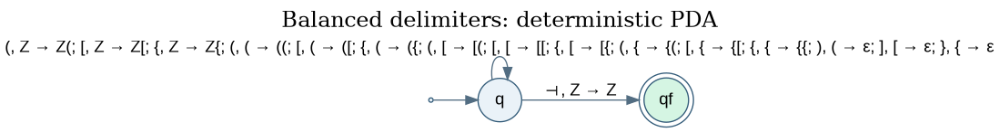
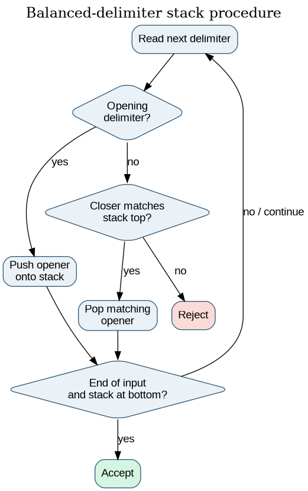
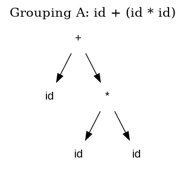
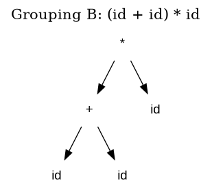
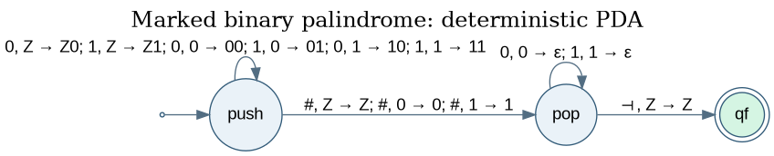
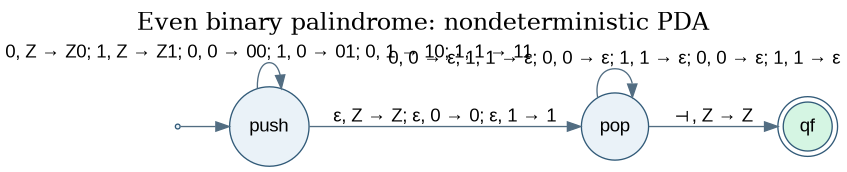
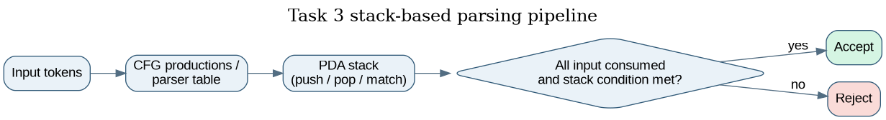

# Pushdown Automata and Context-Free Grammar Case Studies

**Course:** 21CSC301T – Formal Language and Automata, CLA-2, Assessment Task 3  
**Student:** Chris Jero Harsha P (RA2411026050010), B.Tech. CSE – AIML, III Year, Section A  
**Faculty:** Dr. C. Gunasundari, SRM Institute of Science and Technology, Tiruchirappalli

This repository studies language patterns that need stack memory. It contains CFG definitions, deterministic and nondeterministic PDA models, an LL(1) expression parser, stack/parse traces, diagrams, a local browser demonstration, and tests against independent reference checkers.

| # | Case study | Grammar / machine | Main point |
|---|---|---|---|
| 1 | Balanced delimiters | CFG + deterministic PDA (DPDA) | Push each opener; pop only a matching closer |
| 2 | Arithmetic expressions | Ambiguous CFG + precedence grammar + predictive stack parser | Grammar structure determines operator precedence |
| 3 | Binary palindromes | CFG, marked DPDA, and unmarked even-palindrome NPDA | A midpoint marker removes the need to guess the split |

The third case study includes both the marked language `w#reverse(w)` and the unmarked even-length language `wwᴿ`. The former is modelled by a deterministic PDA because `#` marks the midpoint; the latter uses an epsilon transition to guess the midpoint and is therefore nondeterministic in this implementation.

## Run it

Python 3.10 or newer is recommended. Install the development dependencies (pytest is used for the test suite):

```bash
python -m pip install -r requirements-dev.txt
```

Run all Task 3 demonstrations:

```bash
python -m fla_project
```

Run one case study and print its processing trace:

```bash
python -m fla_project brackets '([]{})'
python -m fla_project expr 'id+id*id'
python -m fla_project palindrome '001#100'  # marked palindrome: w#reverse(w)
python -m fla_project palindrome '0110'     # unmarked even palindrome: wwᴿ
```

Run tests and rebuild the diagrams:

```bash
python -m pytest -q                 # 7 pytest test functions
python tools/render_diagrams.py     # requires Graphviz (dot)
```

Existing PNG and SVG diagrams are included. Graphviz is required only to regenerate them from their `.dot` source files.

## Browser demonstration

Open `docs/index.html` in a web browser. The page is a static local demonstration. Select a case study, enter a string, and inspect the accept/reject result and explanation. The page does not send input to a server.

## 1. Balanced delimiters

The language contains properly nested round, square, and curly brackets. The CFG is:

```text
S -> ( S ) S
   | [ S ] S
   | { S } S
   | ε
```

The PDA uses a stack with bottom marker `Z`:

- On `(`, `[` or `{`, it pushes that opening symbol.
- On `)`, `]` or `}`, it consumes the closer only when the stack top contains the corresponding opener, then pops it.
- A mismatched closer has no valid transition.
- An explicit right-end marker `⊣` allows acceptance only when the stack has returned to its bottom marker.





For example, `{[()]}` is accepted because each closer matches the most recent unmatched opener. The string `([)]` is rejected because `)` is encountered while `[` is on top of the stack.

## 2. Arithmetic expressions

The project analyses an ambiguous expression grammar:

```text
E -> E + E
   | E * E
   | ( E )
   | id
```

For `id+id*id`, the grammar permits two groupings: `id+(id*id)` and `(id+id)*id`. Replacing the identifiers with `2`, `3`, and `4` gives different results:

```text
2 + (3 * 4) = 14
(2 + 3) * 4 = 20
```

The two parse-tree figures illustrate why the ambiguous grammar does not specify a unique precedence interpretation:





The revised grammar separates expression (`E`), term (`T`), and factor (`F`) levels. Multiplication is handled at the term level, so it has higher precedence than addition:

```text
E  -> T E'
E' -> + T E' | ε
T  -> F T'
T' -> * F T' | ε
F  -> ( E ) | id
```

The LL(1) parser uses a predictive parsing table and an explicit stack. It returns a step-by-step trace showing grammar expansions, terminal matches, and acceptance or rejection. The supported expression syntax includes identifiers or integers, parentheses, addition, and multiplication; it is not a complete programming-language grammar.

## 3. Binary palindromes

The CFG generates binary palindromes:

```text
P -> 0 P 0
   | 1 P 1
   | 0
   | 1
   | ε
```

### Marked midpoint: `w#reverse(w)`

When the input contains `#`, the marker identifies the midpoint. The DPDA pushes the binary prefix, reads `#`, and then compares the remaining suffix with the stack in reverse order. Each matching symbol is popped.



Example: `001#100` is accepted because the suffix is the reverse of the prefix.

### Unmarked even palindrome: `wwᴿ`

Without a midpoint marker, the machine cannot identify the split by reading a special separator. The NPDA uses an epsilon transition to guess when to switch from pushing the first half to popping and matching the second half.



Example: `0110` is accepted, while `0101` is rejected because no midpoint choice gives a complete mirrored match.

## Determinism and stack memory

| Case | Machine used | Determinism in this implementation |
|---|---|---|
| Balanced delimiters | PDA | Deterministic |
| Precedence-aware arithmetic expressions | Predictive stack parser | Deterministic / LL(1) |
| Marked palindrome `w#reverse(w)` | PDA | Deterministic |
| Unmarked even palindrome `wwᴿ` | PDA with epsilon midpoint guess | Nondeterministic |

A finite automaton has only a fixed finite control state and cannot store an arbitrarily deep sequence of unmatched opening delimiters. A PDA adds last-in, first-out stack memory, which is the key mechanism used by the delimiter and palindrome models. The arithmetic parser also uses a stack to expand grammar variables and match terminals.

The simulator explores PDA configurations with breadth-first search and has a configurable maximum of 50,000 configurations to prevent an unbounded search in the demonstration program.



## Test coverage

Run `python -m pytest -q` to execute the seven test functions. The suite checks accepted and rejected delimiter examples, all short strings up to length four over a small delimiter/test alphabet against an independent stack checker, valid and malformed arithmetic expressions, expression precedence and the two ambiguous evaluations, marked and unmarked palindrome examples, bounded binary-string cross-checks, and PDA determinism properties.

The saved test output and model properties are available in `docs/results/pytest_output.txt` and `docs/results/model_metrics.json`.

## Modelling limitations

- The balanced-delimiter PDA models delimiter tokens. A source-code checker needs a lexer to ignore delimiters inside strings and comments and a larger grammar for the programming language.
- The arithmetic parser supports identifiers or integers, parentheses, addition, and multiplication. It does not implement a complete programming language or every operator.
- The nondeterministic PDA simulator explores a finite number of configurations per run; the configured search cap is an implementation safeguard, not a change to the formal language definition.
- The models are teaching demonstrations, not production compiler components.

## Layout

```text
fla_project/
  __main__.py                 package entry point
  task3/
    pda.py                    PDA transition model, simulator and three PDA builders
    grammars.py               CFG definitions, expression parser and derivation helpers
    cases.py                  case-study machines and accepted/rejected examples
    cli.py                    terminal demonstrations and traces
tests/
  test_task3.py                pytest examples and independent cross-checks
tools/
  render_diagrams.py           rebuilds PNG/SVG figures from Graphviz DOT files
docs/
  index.html                   local browser demonstration
  task3_pda_cfg.md              formal model and grammar notes
  diagrams/                    PNG, SVG and DOT figures / parse trees
  results/                     test output, model properties and validation summary
report/
  Chris_Jero_Harsha_FLA_Task_3_Report.pdf
```

## References and attribution

The reference coursework repository informed the broad implementation level and presentation structure. The grammar choices, state transitions, examples, code, tests, and diagrams in this package are a separate adaptation.

- Reference repository: [FLA-Task3-PDA-CFG-Case-Studies](https://github.com/Vaishakkr/FLA-Task3-PDA-CFG-Case-Studies)
- J. E. Hopcroft, R. Motwani and J. D. Ullman, *Introduction to Automata Theory, Languages, and Computation*, 3rd ed., Pearson, 2007.
- A. V. Aho, M. S. Lam, R. Sethi and J. D. Ullman, *Compilers: Principles, Techniques, and Tools*, 2nd ed., Pearson, 2007.

## Academic integrity note

This repository is an AI-assisted working draft. Review the grammars and source code, run the tests, and make sure you can explain the transitions, stack operations, parser behaviour, and limitations. Follow your institution's rules for AI acknowledgement and individual coursework before submission.
